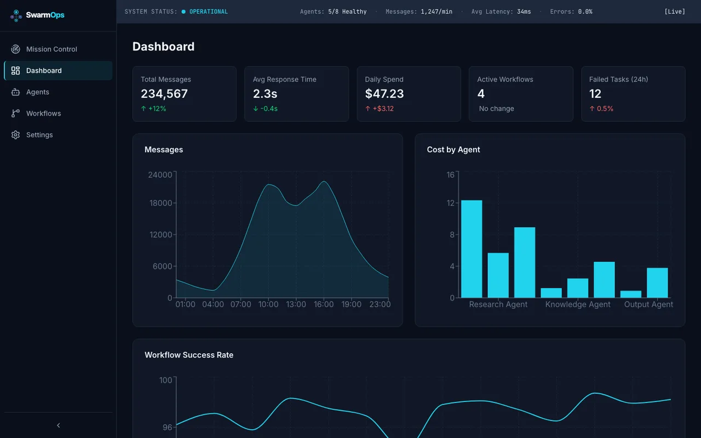
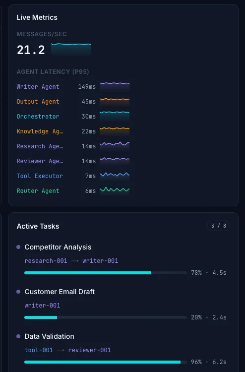
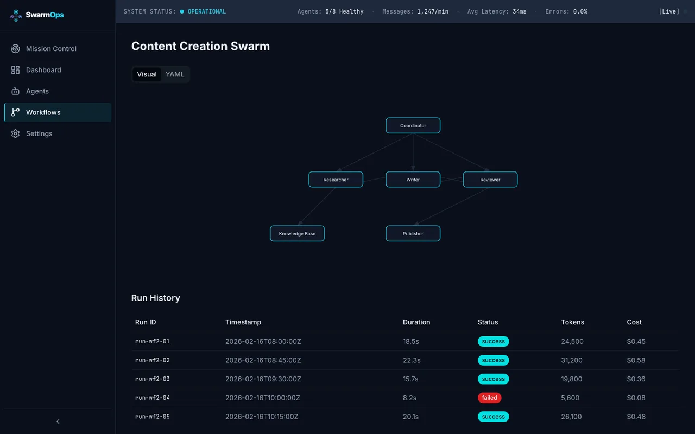

# SwarmOps — AI agent orchestration dashboard template

A free MIT Next.js template of an AI agent orchestration dashboard. It runs on sample data, and no number in it is a measured result.



## Pages

Every page reads from the sample data in `src/lib/mock-data.ts` (Mission Control from a simulated swarm in `src/lib/swarm-context`). Nothing talks to a server.

### `/` — landing page
Hero, a small topology preview, architecture patterns, a features grid, a stats section and a footer. Scroll animation uses GSAP ScrollTrigger and Lenis.

### `/login` — mock sign-in
An email and password form. There is no authentication: submitting sends you to `/mission-control`. The "Sign up" label is not a link.

### `/dashboard` — analytics
Five stat cards (messages, response time, daily spend, active workflows, failed tasks), then charts for messages per hour, cost by agent and workflow success, an agent utilization heatmap and a bottlenecks table.

### `/mission-control` — live view
Four panels: agent topology map, live metrics, message stream and active tasks.



### `/workflows` and `/workflows/[id]` — workflows
A card grid of workflows with pattern, agent count, run count and status. A detail page shows the workflow name and its run history. Pre-rendered for the four sample workflows.



### `/agents/[id]` — agent detail
Tabs: Overview, Configuration, Logs, Connections and Evaluation. Pre-rendered for each sample agent.

### `/settings` — settings
Tabs for API keys, webhooks, integrations, alert rules and team members. All sample data; nothing is saved.

## Run

```bash
npm install
npm run dev      # http://localhost:3000
npm run build    # static export into out/
```

`next.config.ts` sets `output: "export"`, so the build is plain static files.

Add new UI components with `npx shadcn@latest add <name>`.

## Deploy

[](https://vercel.com/new/clone?repository-url=https%3A%2F%2Fgithub.com%2Fnesaminua%2Fagent-orchestration-dashboard)

Any static host works:

1. Run `npm run build`.
2. Upload the contents of `out/` to the host.
3. Serve `index.html` for `/`. Each route also has its own `.html` file or folder in `out/`.

## Connect your own agents

The sample app does not read trace events itself. It shows fixed sample data.

To feed a dashboard like this from real agents, `trace-kit/` holds the event format: a JSON Schema for one event per agent step, a mapping to OpenTelemetry GenAI span attributes, and a checklist of what each dashboard panel needs. You write the code that collects events and replaces the sample data.

## More

- Case study: https://madsalt.tech/work/multi-agent-orchestration/
- Trace kit: https://madsalt.tech/kits/agent-trace-kit/

## Licence

The template code is MIT, see `LICENSE`. Dependencies keep their own licences. This includes GSAP, which is used under its Standard "No Charge" licence (https://gsap.com/standard-license/): free for commercial use, but not for tools that let users build visual animations without code in competition with Webflow. Check it before you use this template for such a tool.
